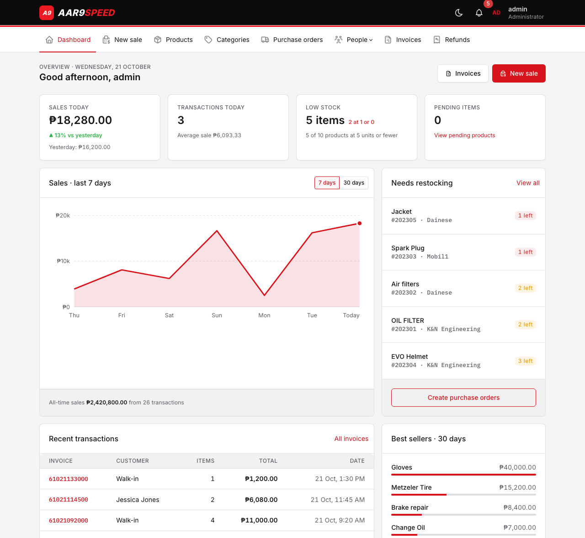
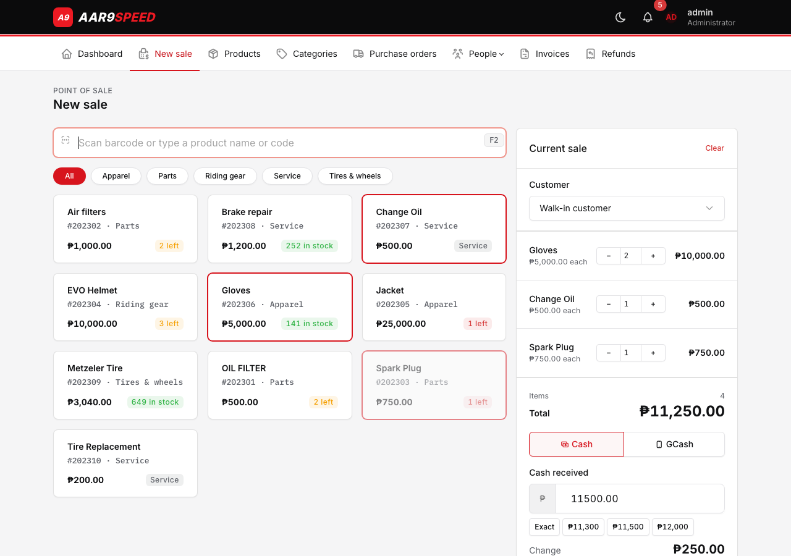
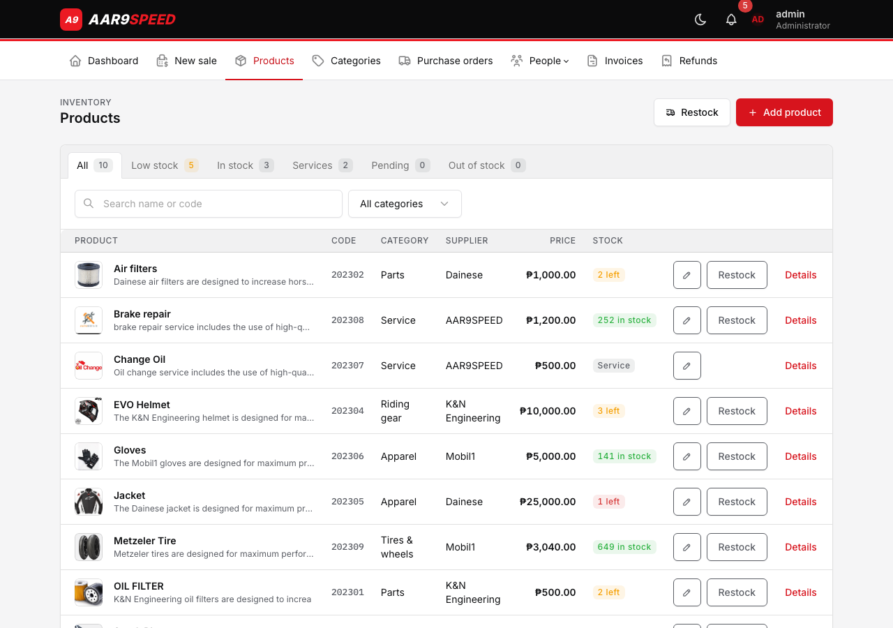
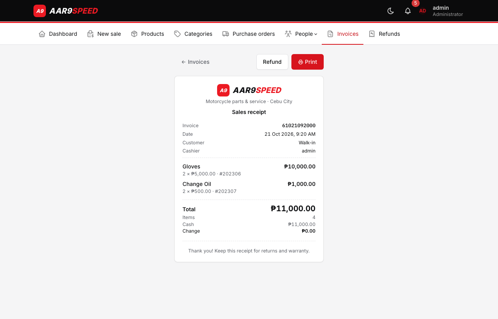
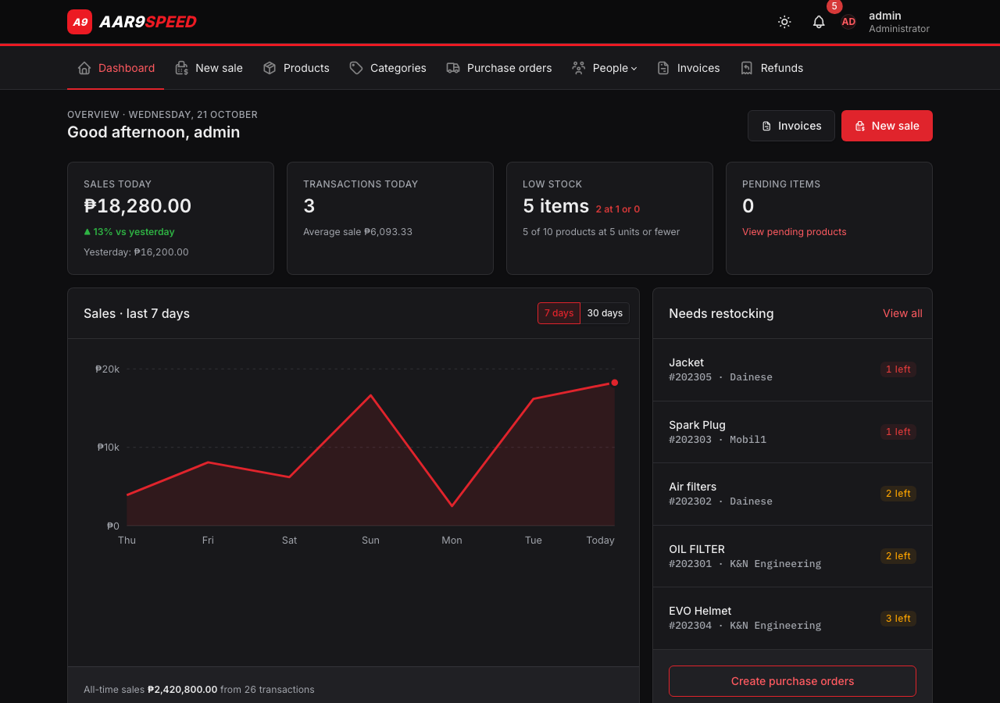
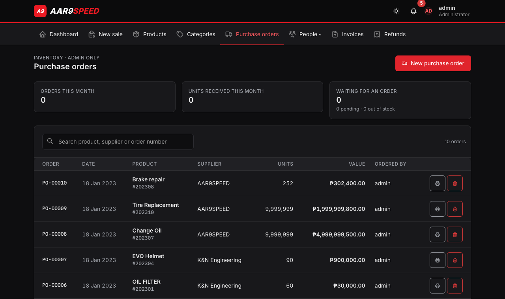
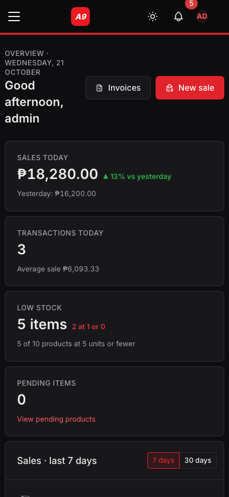
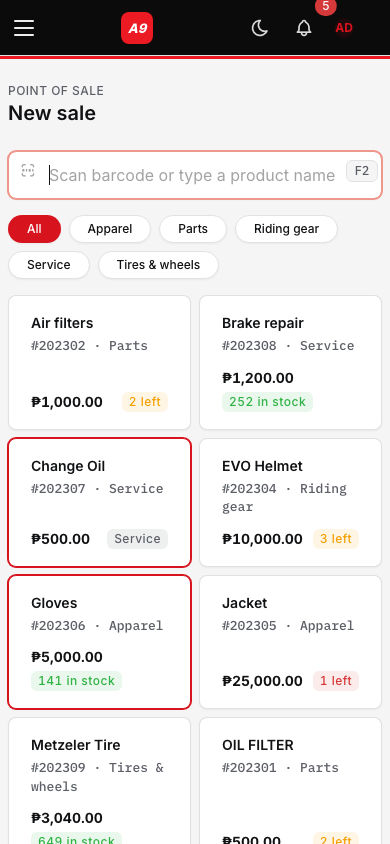
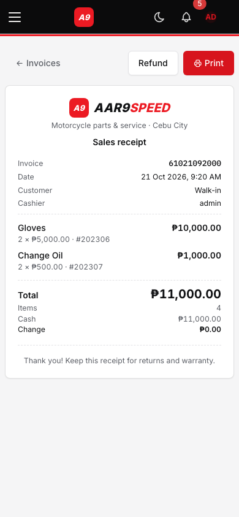
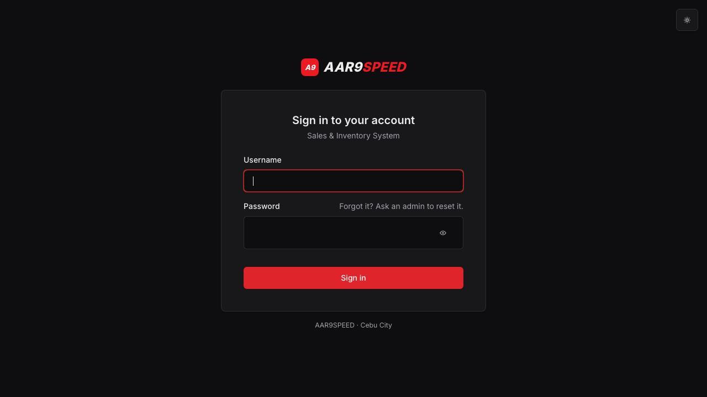

# AAR9SPEED Sales & Inventory System

A web-based sales and inventory management system built for a motorcycle shop (Philippines). Manages customers, products, staff, suppliers, purchase orders, and transactions.

---

## Features

| Module | Description |
|---|---|
| **Dashboard** | Total sales (PHP), transaction count, best-sellers bar chart, live notification bell |
| **Customers** | Full CRUD — name, email, phone, address |
| **Products / Inventory** | Full CRUD with image upload, category/supplier linking, product code, status workflow |
| **Inventory Status** | ACTIVE → INACTIVE trigger at 0 qty; separate views for pending and inactive items |
| **Categories** | CRUD for product categories |
| **Suppliers** | CRUD for supplier companies and contacts |
| **Staff** | Admin-gated CRUD with role assignment (ADMIN / STAFF) |
| **Purchase Orders** | Admin-gated stock replenishment; automatically increments on-hand quantity |
| **New sale (point of sale)** | `Sale.php`: barcode/search, category filter, cart, cash (with change) or GCash with reference; server checks prices and stock and saves the invoice in one transaction |
| **Invoices** | Lists all transactions grouped by transaction code |
| **Receipts** | `transaction.php?code=`: printable receipt (fits 80 mm thermal paper) with items, payment method, change and refunds |
| **Notifications** | AJAX-polled dropdown showing depleted (<6 qty), pending, and inactive items |
| **Account Update** | Logged-in staff can update their own profile |

---

## Screenshots

Screenshots use sample data. Every page has a light and a dark mode (switch in the top bar) and works on phones.

**Dashboard:** today's sales compared with yesterday, a 7/30-day sales chart, items to restock, recent invoices and best sellers.



**New sale:** scan a barcode or search, tap products into the cart, then take cash (with change) or GCash.



**Products:** status tabs, search, category filter and stock labels; add, edit and restock from here.



**Receipt:** opens after each sale; prints at thermal-receipt width.



**Dark mode**

| Dashboard | Purchase orders |
|---|---|
|  |  |

**On a phone**

| Dashboard (dark) | New sale | Receipt |
|---|---|---|
|  |  |  |

**Sign in**



---

## Tech Stack

- **Backend**: PHP 8.1, PDO (MariaDB/MySQL)
- **Frontend**: Tabler 1.6 (Bootstrap 5), Tabler Icons, jQuery 3.6.3, light/dark mode
- **Database**: MariaDB 10.4 / MySQL

---

## Requirements

- PHP 8.1+
- MySQL / MariaDB
- A web server (Apache with mod_rewrite, or Nginx, or XAMPP/Laragon locally)

---

## Setup

1. **Clone or copy** the project into your web server's document root (e.g., `htdocs/` for XAMPP).

2. **Import the database and run the migrations** — into a database named `aar9speed`:
   ```bash
   mysql -u root -p aar9speed < aar9speed.sql
   mysql -u root -p aar9speed < migrations/002_improvements.sql
   mysql -u root -p aar9speed < migrations/003_automation.sql
   mysql -u root -p aar9speed < migrations/005_widen_contact_fields.sql
   mysql -u root -p aar9speed < migrations/006_payment_method.sql
   mysql -u root -p aar9speed < migrations/007_notify_outbox.sql
   php migrations/004_hash_passwords.php   # after step 3; converts any plain-text passwords
   ```
   The seed data creates one account, `admin`. Get its initial password from the project owner and change it after your first login. Plain-text passwords are no longer accepted at login, so existing databases must run `004_hash_passwords.php` before upgrading.

3. **Configure database credentials** — copy `.env.example` to `.env` and fill in your values:
   ```
   DB_HOST=localhost
   DB_USER=your_db_user
   DB_PASS=your_db_password
   DB_NAME=aar9speed
   ```
   `.env` is excluded from git by `.gitignore` so credentials stay off version control.

4. **Set folder permissions** — the `images/` directory must be writable:
   ```bash
   chmod 755 images/
   ```

5. **Open in browser** — navigate to `http://localhost/AAR9SPEED-sales-and-Invertory-System/login.php`

---

## Deploying

To put the system online on free hosting (InfinityFree) with automatic deploys from GitHub, follow **[docs/DEPLOY.md](docs/DEPLOY.md)**. `.htaccess` keeps `.env`, the database dump and the server-side folders from being downloaded.

---

## Automation

The system sends two automatic messages to **Discord**, **Telegram**, or both (whichever is set up in `.env`):

| Automation | When | What it sends |
|---|---|---|
| **Low-stock alert** | Whenever an item reaches `LOW_STOCK_THRESHOLD` (default 5) or runs out | One grouped message listing the items. Each item alerts once, again if it hits 0, and resets after it is restocked |
| **Daily sales report** | First scheduler run at or after `DAILY_REPORT_TIME` (default 21:00) | Today's sales vs yesterday, transactions, items sold, refunds, top 3 best sellers, and items to restock |

### Setup

1. **Run the migration:** `mysql -u root -p aar9speed < migrations/003_automation.sql`
2. **Choose where messages go** (one or both):
   - **Discord:** in your server, open the channel → **Edit Channel → Integrations → Webhooks → New Webhook**, name it, and **Copy Webhook URL**. Put it in `.env` as `DISCORD_WEBHOOK_URL`. Mentions such as `@everyone` are never sent.
   - **Telegram:** message [@BotFather](https://t.me/BotFather), send `/newbot`, and copy the token into `TELEGRAM_BOT_TOKEN`. Send any message to the bot, open `https://api.telegram.org/bot<TOKEN>/getUpdates`, and copy `"chat":{"id": …}` into `TELEGRAM_CHAT_ID` (group IDs start with `-`).
3. **Set a long random `CRON_SECRET`** in `.env`:
   ```bash
   php -r "echo bin2hex(random_bytes(24));"
   ```
4. **Test it:** `php cron.php test` (or open `cron.php?key=YOUR_CRON_SECRET&task=test`). A "connected" message should arrive.

The webhook URL and bot token work like passwords: anyone who has them can post to your channel. Keep them only in `.env`.

### How the scheduler runs

`cron.php` runs whatever is due. It can be triggered three ways; use whichever your host allows:

- **Server cron** (VPS or hosts with cron): `*/5 * * * * php /path/to/cron.php`
- **External pinger**: [cron-job.org](https://cron-job.org) or `.github/workflows/scheduler.yml` (set the `SCHEDULER_URL` secret) calling `https://your-site/cron.php?key=YOUR_CRON_SECRET` every 5–15 minutes. Some free hosts, including InfinityFree, block non-browser requests, so check that the call returns JSON.
- **Built-in fallback**: the notification bell, which every page polls, also runs the scheduler at most once every `SCHEDULER_INTERVAL_MINUTES`. This needs no setup, but only works while someone is logged in.

Other tasks: `cron.php?key=…&task=report` sends today's report immediately.

---

## Project Structure

```
├── .env / .env.example              # Settings (DB, Telegram, timezone); .env is gitignored
├── config/Database/Database.php     # PDO connection (reads .env)
├── Model/                           # Data access classes (extend Database)
│   ├── Sale.php                     # Checkout: locks stock, saves invoice lines
│   ├── Product.php, Category.php, Supplier.php, Customer.php, Staff.php
│   ├── Order.php                    # Purchase orders (createPurchase)
│   ├── Invoice.php, Refund.php      # Invoices, receipts, refund limits
│   ├── Dashboard.php, Notification.php
│   └── logout.php
├── ajax/                            # JSON / form handlers (login + CSRF checked)
│   ├── saleOperation.php            # checkout
│   ├── operation.php                # customers, suppliers, staff, categories
│   ├── ProdOperation.php            # addStock
│   ├── itemInsert.php, updateProduct.php   # product add / edit with image upload
│   ├── orderOperation.php, deleteOrder.php # purchase orders (admin)
│   ├── refundOperation.php          # invoice lines, refunds
│   ├── notification.php             # bell feed (+ automation fallback)
│   └── updatingUser.php             # "Update my account"
├── site/
│   ├── layout/                      # head, navbar, scripts, chart (Tabler layout)
│   ├── protected.php, require_admin.php, admin_gate*.php   # login and admin checks
│   ├── csrf.php, validate.php, audit.php, upload.php
│   ├── automation.php, telegram.php # scheduled alerts and reports
│   ├── product_status_page.php      # shared Pending / Out of stock list
│   └── dataUser.php                 # account dialog
├── styles/tabler-theme.css          # Brand colours, dark mode, print styles
├── scripts/jquery-3.6.3.js
├── migrations/                      # 002–006 SQL + 004 password script
├── tests/smoke.sh                   # logs in and loads every page (used by CI)
├── cron.php                         # automation scheduler endpoint
├── img/                             # Logo and favicon
├── images/                          # Uploaded product photos (gitignored)
│
├── login.php, Dashboard.php, Sale.php
├── Product.php, ProductView.php, pendingProduct.php, InactiveProduct.php, Category.php
├── Order.php, print_order.php, Securitylogin.php        # purchase orders (admin)
├── Customer.php, Supplier.php, Staff.php, SecurityCheck.php
└── invoice.php, transaction.php, Refund.php
```

---

## Recommended Improvements

The system works but was built as a college capstone project. The following improvements will bring it up to production quality.

### Priority 1 — Security (do these first)

| # | Issue | Fix |
|---|---|---|
| 1 | ~~**Passwords stored in plaintext**~~ | ✅ Done — `password_hash` / `password_verify`; plain-text fallback removed, `migrations/004_hash_passwords.php` converts old accounts |
| 2 | ~~**Hardcoded DB credentials in source**~~ | ✅ Done — moved to `.env`, gitignored |
| 3 | **No CSRF protection** | Add CSRF tokens to all state-changing forms and AJAX calls |
| 4 | ~~**Unrestricted file upload**~~ | ✅ Done — MIME + extension whitelist + 5 MB limit |
| 5 | **SecurityCheck admin gate is bypassable** | Fix OR logic — check that BOTH role AND password match, never trust a hidden form field for the role |
| 6 | **No HTTPS enforcement** | Redirect HTTP to HTTPS; set `secure` and `httponly` flags on the session cookie |
| 7 | **PDO error messages exposed** | Connection errors now logged instead of shown ✅; query errors still need handling |
| 8 | **Remaining XSS risks** | Apply `htmlspecialchars()` everywhere DB data is echoed into HTML |

### Priority 2 — Code Quality

| # | Issue | Fix |
|---|---|---|
| 1 | ~~**Class names are typos**~~ (`Cstomer`, `Prduct`, `Ordr`, etc.) | ✅ Done — renamed to proper names |
| 2 | **`extract()` on DB results** | Replace with explicit variable assignments |
| 3 | **HTML built by string concatenation in PHP** | Extract into proper view templates |
| 4 | **No autoloading / no Composer** | Add `composer.json` and PSR-4 autoloading |
| 5 | **SecurityCheck and Securitylogin are identical files** | Merge into one reusable component |

### Priority 3 — Features & UX

| # | Feature | Notes |
|---|---|---|
| 1 | **Role-based access control** | Add proper role checks on every action, not just page entry |
| 2 | **PDF invoices / reports** | Use DOMPDF or FPDF to generate downloadable invoices and sales reports |
| 3 | **Barcode / QR on receipts** | Scan product codes at point of sale |
| 4 | **Monthly sales analytics** | Expand the dashboard with trend charts and inventory turnover |
| 5 | ~~**Low-stock email/SMS alerts**~~ | ✅ Done — Telegram low-stock alerts and daily sales report (see [Automation](#automation)) |
| 6 | **Audit log** | Record who changed what and when |
| 7 | ~~**Return / refund workflow**~~ | ✅ Done — `Refund.php`, limited to items on the invoice and to sold minus already refunded |
| 8 | **Server-side pagination** | DataTables is already loaded — enable server-side mode for large datasets |

### Priority 4 — Modern Stack (long-term)

- Adopt **Laravel** or **Slim** for routing, middleware, ORM, and built-in security helpers
- Use **Vite** instead of manually loading CDN scripts
- Write unit tests for Model classes with **PHPUnit**
- ~~Set up **CI** (GitHub Actions) to lint and test on every push~~ ✅ Done — `.github/workflows/ci.yml` lints on PHP 8.1/8.3 and runs `tests/smoke.sh` (logs in and loads every page on MySQL 8)
- Set up **CD**: deploy to hosting after CI passes on `main`

---

## Bugs Fixed (June 2025 cleanup)

### Security pass
- SQL injection in `login.php` — switched from MySQLi raw queries to PDO prepared statements
- `showProductActive()` — broken SQL `WHERE ITEM_STATUS = 'ACTIVE' >= 1` corrected
- `Quantity()` — `AND` replaced with `,` in SET clause; missing `:SUPPLIER_ID` binding added
- `showDeplated()` — invalid `GROUP BY subject DESC` corrected
- `notification.php` — pending items gated behind wrong method (`showdepleted` instead of `showPending`)
- `filterItem()`, `showDetails()`, `getITEM()`, `placeInput()`, `placeInput2()`, `updateQuantity()` — SQL injection via string interpolation replaced with bound parameters
- Blank `alert()` firing on every page load removed from `sidebar.php`
- Debug `echo $_POST[...]` removed from `inserPurchase.php` and `itemInsert.php`
- Session auth guard added to all unprotected AJAX endpoints
- Duplicate `particles.js`, Bootstrap, jQuery loads cleaned up in `SecurityCheck.php`
- `htmlspecialchars()` added to session username and notification item name output
- Removed dead files: `shActive.php`, `particle.css`, `Model/Login.php`, `image.php`, `fpdf17/`, `customfont/`, `styles/updateAccount.php`

### Structure & further security pass
- **Model class names corrected** — renamed 9 typo classes (`Cstomer`→`Customer`, `Prduct`→`Product`, `Ordr`→`Order`, etc.) with all 28 referencing files updated
- **AJAX handlers moved to `ajax/`** — 9 handler files relocated; all JS call sites and form actions updated
- **`des.css` moved to `styles/`** — eliminated root-level CSS clutter
- **Password hashing** — `login.php` now uses `password_verify()` with seamless auto-rehash for existing plaintext passwords; new staff inserted/updated with `password_hash()`
- **DB credentials moved to `.env`** — `Database.php` reads from `.env` via a no-Composer env loader; `.env` is gitignored
- **File upload validation** — MIME type check (`finfo`), extension whitelist (jpg/png/webp/gif), 5 MB limit added to `ajax/itemInsert.php` and `ajax/updateProduct.php`
- **`transaction.php` broken path** — `../FinalProject/styles/stylish.php` corrected to `styles/stylish.php`

---

*Built by Jez — AAR9SPEED capstone project, Jan 2023. Cleaned up June 2025.*
